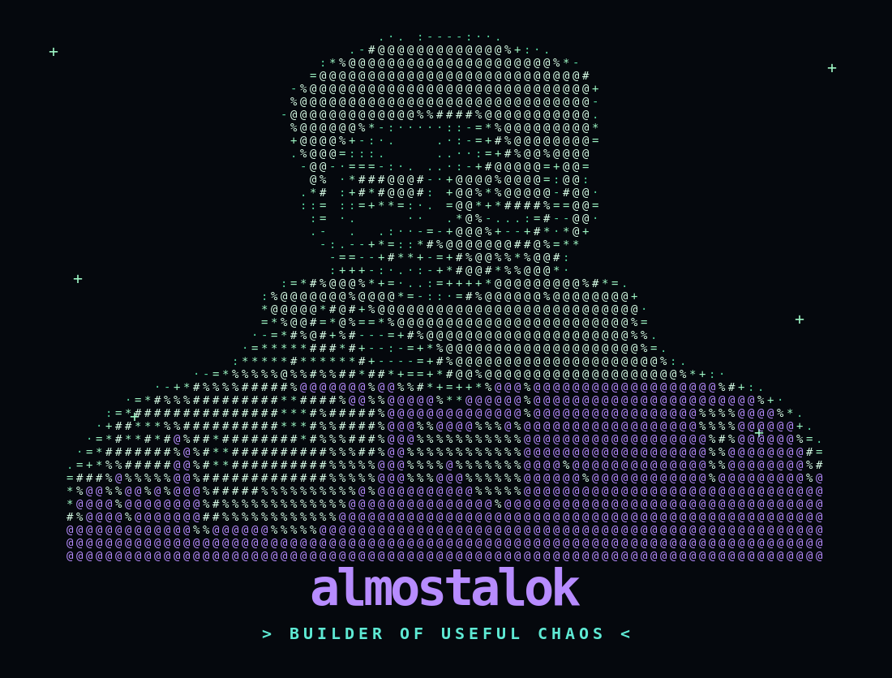
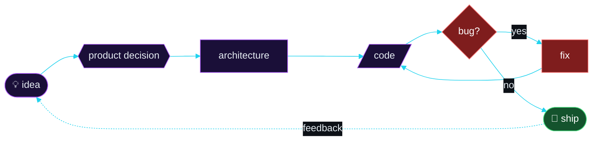

<!-- ============================================================
ALMOSTALOK // TERMINAL PROFILE v2
Assets live in ./assets (animated SVGs, safe for GitHub READMEs).
Colour theme: #0D1117 bg · #A855F7 purple · #22D3EE cyan · #4ADE80 green
============================================================= -->

<div align="center">



<br>

<a href="https://almostalok.tech"></a>
<a href="https://almostalokblogs.tech"></a>
<a href="https://almostalokresume.tech"></a>

<a href="https://linkedin.com/in/alokkumarsingh"></a>
<a href="https://twitter.com/almostalok"></a>
<a href="https://instagram.com/almostalok"></a>
<a href="https://youtube.com/c/almostalok"></a>

<br><br>


</div>

<br>

<div align="center">

</div>

<br>


<table>
<tr>
<td width="42%" valign="top">



</td>
<td width="58%" valign="top">

```ts
// profile.ts
const alok = {
  name:       "Alok Kumar Singh",
  handle:     "@almostalok",
  role:       ["Developer", "Product Builder"],
  building:   "Hospate",
  location:   "India",
  focus:      "Useful products, real people",
  education:  "Learning. Always.",
  philosophy: "Ship > Perfection",
  hobbies:    ["Code", "Coffee", "Ideas", "Overthinking"],
  funFact:    "My quick fixes become full features.",
} as const;

export default alok;
```

```ini
[system_status]
Building   = Hospate            █████████░ 90%
Learning   = System Design      ███████░░░ 70%
Exploring  = Product + Growth   ██████░░░░ 60%
Open_To    = Exciting Problems  ████████░░ 80%
Caffeine   = Necessary          ██████████ 100%
```

</td>
</tr>
</table>

<br>


<div align="center">

</div>

<br>


> **HOSPATE** — cleaner workflows for real people.
> Not another dashboard built only to impress a screenshot. Real problems. Real users. Real impact.

<div align="center">

</div>



```bash
#!/usr/bin/env bash
# ship.sh — the entire Hospate philosophy in a few lines
set -euo pipefail

echo "> compiling ideas..."
echo "> deleting unnecessary complexity..."
npm run build && npm test || echo "> bug found. fixing. again."
echo "> shipping anyway."
```

<br>


<div align="center">

<br><br>

<br>

<br>

</div>

<br>


<table>
<tr>
<td width="50%">

</td>
<td width="50%">

</td>
</tr>
</table>

<div align="center">

<br><br>

</div>

> *"A green square cannot deploy an API. But it looks pretty cool."*

<br>


<div align="center">

<br><br>

</div>

<br>


<table>
<tr>
<td width="50%" valign="top">

```ini
[links]
Portfolio  = almostalok.tech
Blog       = almostalokblogs.tech
Resume     = almostalokresume.tech
Twitter    = @almostalok
LinkedIn   = /in/alokkumarsingh
Instagram  = @almostalok
YouTube    = /c/almostalok
```

</td>
<td width="50%" valign="top">

```bash
#!/usr/bin/env bash
# hire.sh
PROBLEM="${1:-something exciting}"

echo "> reading: $PROBLEM"
echo "> coffee: 100%"
echo "> let's build something"
echo "  worth shipping."
```

</td>
</tr>
</table>

<details>
<summary><code>coding_profiles@dev:~$ ./links</code> &nbsp;— challenge me in public</summary>

<br>

<!-- Replace each URL with your real profile link -->

| Judge | Judge |
|:--|:--|
| [LeetCode](https://leetcode.com/u/almostalok) | [HackerRank](https://www.hackerrank.com/profile/almostalok) |
| [Codeforces](https://codeforces.com/profile/almostalok) | [AtCoder](https://atcoder.jp/users/almostalok) |
| [CodeChef](https://www.codechef.com/users/almostalok) | [GeeksforGeeks](https://auth.geeksforgeeks.org/user/almostalok) |
| [HackerEarth](https://www.hackerearth.com/@almostalok) | [Topcoder](https://www.topcoder.com/members/almostalok) |

</details>

<br>


```ini
[available_commands]
whoami    = Know more about me
projects  = See what I'm building
tech      = My tech stack
stats     = GitHub analytics
socials   = Find me online
hire      = Let's build together
clear     = Because clean terminals = happy mind

; $ sudo hire_me
; > permission granted. let's build something worth shipping.
```

<div align="center">

<a href="https://www.buymeacoffee.com/almostalok"></a>
&nbsp;
<a href="https://ko-fi.com/almostalok"></a>

<br><br>

```bash
almostalok@dev:~$ ./shutdown
> process still running.   > feature queue not empty.
> curiosity still active.  > sleep.service still missing.
# "Still a work in progress... but the commits are getting better."
```


</div>
