<!-- ============================================================
ALMOSTALOK // PROFILE v3 — one long animated SVG
Everything visual lives in ./assets/profile.svg (single file, nothing else to 404).
Below it: clickable links + live widgets that must stay outside the SVG.
============================================================= -->

 

  

---

### `projects@dev:~$ ls --links`

| Project | What it is |
|:--|:--|
| [**hospate_demo**](https://github.com/almostalok/hospate_demo) | HospateOS, an internal hospital ERP used day to day across reception, clinical, pharmacy, lab, billing, HR and admin teams |
| [**subguard**](https://github.com/almostalok/subguard) | India-first recurring-payment guardian for UPI AutoPay, cards, standing instructions and subscriptions |
| [**almosthack**](https://github.com/almostalok/almosthack) | Transparent hackathon operating system with a developer-first aesthetic |
| [**sync**](https://github.com/almostalok/sync) | SiteSync, a planning-to-reality platform for infrastructure projects (Smart India Hackathon 2026) |
| [**Ray**](https://github.com/almostalok/Ray) | Autonomous revenue-recovery and economic decision engine for Razorpay |
| [**arm**](https://github.com/almostalok/arm) | AI-powered relationship management and modern CRM platform |
| [**tenant**](https://github.com/almostalok/tenant) | Multi-tenant SaaS starter: schema-per-tenant Postgres, JWT auth, RBAC, Stripe billing |
| [**bookify**](https://github.com/almostalok/bookify) | Book discovery, reading tracker and personal library platform |
| [**devils-advocate**](https://github.com/almostalok/devils-advocate) | Minimalist debate and rhetoric crucible |

---

### `github_stats@dev:~$ ./analyze`

<table>
<tr>
<td width="50%">

</td>
<td width="50%">

</td>
</tr>
</table>

  

  

> *"A green square cannot deploy an API. But it looks pretty cool."*

---

<code>coding_profiles@dev:~$ ./links</code> &nbsp;— challenge me in public

 

<!-- Replace each URL with your real profile link -->

| Judge | Judge |
|:--|:--|
| [LeetCode](https://leetcode.com/u/almostalok) | [HackerRank](https://www.hackerrank.com/profile/almostalok) |
| [Codeforces](https://codeforces.com/profile/almostalok) | [AtCoder](https://atcoder.jp/users/almostalok) |
| [CodeChef](https://www.codechef.com/users/almostalok) | [GeeksforGeeks](https://auth.geeksforgeeks.org/user/almostalok) |
| [HackerEarth](https://www.hackerearth.com/@almostalok) | [Topcoder](https://www.topcoder.com/members/almostalok) |

<code>about.txt</code> &nbsp;— plain-text version of the animation above

 

**Alok Kumar Singh** (@almostalok) is a developer and product builder from India, currently building **Hospate**, a hospital ERP focused on cleaner workflows for real people. Philosophy: *Ship > Perfection.* Learning system design, exploring product and growth, open to exciting problems.

**Stack:** HTML, CSS, JS, TS, React, Next, Tailwind · Node, Express, NestJS, Python, Java, GraphQL · MongoDB, PostgreSQL, MySQL, Redis, Docker, AWS · Git, Figma, Jest, Linux, Electron, Arduino, Selenium.

&nbsp;

